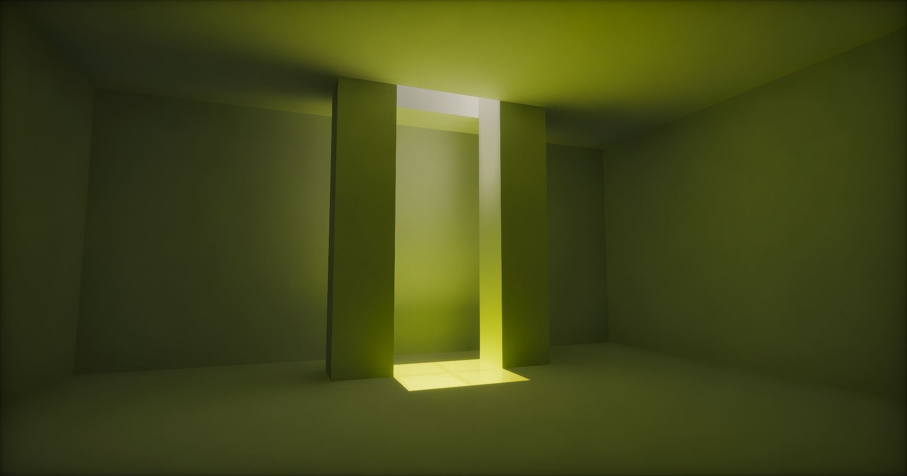

<h1 align="center">Photon PT</h1>

A voxel path-traced fork of Photon Shaders for Minecraft (Iris) by <a href="https://github.com/Ultra119">@Ultra119</a>

> Based on [Photon Shaders](https://github.com/sixthsurge/photon) by [SixthSurge](https://github.com/sixthsurge).  
> This fork brings real-time voxel path-traced global illumination and ray-traced contact occlusion to Photon while preserving its sky, clouds, water, shadows, and post-processing.

## Features

- Real-time voxel path-traced global illumination with multi-bounce indirect lighting and colored block lights
- Ray-traced contact ambient occlusion
- Translucent foliage light transmission and subsurface scattering
- Five quality presets (`Low`, `Medium`, `High`, `Ultra`, and `Screenshot`)
- Revamped sky, weather, aurora, stars, rainbows, and multi-layer volumetric clouds
- Volumetric fog with colored light shafts
- Soft variable-penumbra colored shadows and screen-space reflections
- Realistic water with waves, caustics, and refraction
- Full **labPBR** and **OldPBR** resource pack support (normal/specular mapping and POM)
- TAA, TAAU, FXAA, CAS sharpening, bloom, depth of field, motion blur, and customizable color grading

## Quality Presets

| Preset | Description |
|---|---|
| **Low** | Lightweight quarter-resolution path tracing for maximum performance |
| **Medium** | Balanced half-resolution multi-bounce GI with volumetric fog and RT contact AO |
| **High** | Default gameplay preset with wider GI range, colored shadows, and reflections |
| **Ultra** | Full indirect resampling, water caustics, and colored light shafts |
| **Screenshot** | Native-resolution multi-ray still-frame convergence mode (not intended for gameplay) |

## Installation & Downloads

1. Install [Iris Shaders](https://irisshaders.dev/download).
2. Download the latest archive from the [repository](https://github.com/Ultra119/photon) (or clone it directly into `.minecraft/shaderpacks`).
3. Place the shader pack in `.minecraft/shaderpacks` and select it in Video Settings → Shader Packs.

## Requirements & Compatibility

### Shader Loaders
- **Iris** with `CUSTOM_IMAGES`, `COMPUTE_SHADERS`, and `SSBO` support (**required**)
- **OptiFine is not supported**

### GPUs
- NVIDIA
- AMD
- Intel
- **_NOT_** macOS / Apple Metal (unsupported due to OpenGL compute, SSBO, and custom image limitations)

### Mod Support
- [Distant Horizons](https://modrinth.com/mod/distanthorizons)
- [Voxy](https://modrinth.com/mod/voxy)

## Credits & Acknowledgments

### Techniques, Snippets & Assets
- **[EminGT](https://github.com/EminGT)** ([Complementary Reimagined](https://www.complementary.dev/shaders/)) — Shadow bias method and Fancy Nether Portal effect inspiration
- **[Jessie](https://github.com/Jessie-LC)** — Hardcoded labPBR metal `f0`/`f82` values, atmosphere ozone distribution, multiple-scattering approximations, and GLSL packing/utility snippets
- **[DrDesten](https://github.com/DrDesten)** — SSR depth tolerance calculation and approximate linear depth
- **[Euphoria Patches](https://www.euphoriapatches.com/)** — Block/foliage metadata references
- **[Eric Bruneton](https://ebruneton.github.io/precomputed_atmospheric_scattering/)** — Precomputed atmospheric scattering mapping functions
- **[Sébastien Hillaire](https://sebh.github.io/publications/egsr2020.pdf)** — Sky-view LUT projection (EGSR 2020)
- **[Sledgehammer Games](https://www.sledgehammergames.com/)** — Bloom downsampling/upsampling filter ([Next Generation Post Processing in Call of Duty: Advanced Warfare](http://www.iryoku.com/next-generation-post-processing-in-call-of-duty-advanced-warfare))
- **[AMD FidelityFX CAS](https://github.com/GPUOpen-Effects/FidelityFX-CAS)** & **[Timothy Lottes](https://gpuopen.com/wp-content/uploads/2016/03/GdcVdrLottes.pdf)** — Contrast-Adaptive Sharpening and Lottes tonemapper
- **[ACES](https://github.com/ampas/aces-dev)** & **[MJP (BakingLab)](https://github.com/TheRealMJP/BakingLab)** — ACES tonemapping and Catmull-Rom bicubic filtering
- **Path-Tracing & Sampling Research** — ReSTIR DI & ReSTIR GI (Bitterli et al. 2020; Ouyang et al. 2021; Lin et al. 2022), Spatiotemporal Blue Noise (Wolfe et al., NVIDIA Research), and Kulla–Conty multi-scattering specular energy compensation
- **[Moments in Graphics](http://momentsingraphics.de/)** — Blue noise texture
- **[NASA Scientific Visualization Studio](https://svs.gsfc.nasa.gov/4851)** — Night-sky galaxy texture
- **Thanks to Claude, GPT, Gemini, Copilot, Kimi, GLM, DeepSeek, Grok, Qwen, Llama, and Mistral**

## License

This fork is distributed under the original Photon Shaders License Agreement. See [LICENSE](LICENSE) for full terms and copyright notice (`Copyright © 2021-2025 Benjamin Stott ("SixthSurge")`).
